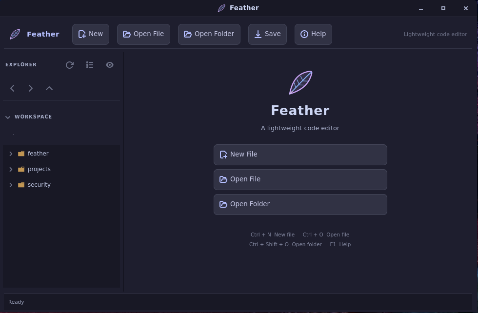

# Feather

<p align="center">
  
</p>

**Feather** is a lightweight native code editor for Linux, built with Rust, GTK 4 and GtkSourceView 5. It provides a focused editing environment with a file explorer, tabbed documents, syntax highlighting and a dark interface.

Feather uses native GTK components rather than an embedded browser or Electron runtime.

## Features

- Native Linux desktop application
- File and workspace explorer
- Tabbed editing with tab reordering and individual close controls
- Syntax highlighting through GtkSourceView 5
- Catppuccin Mocha-inspired dark interface
- VS Code file and folder icon assets from the upstream `vscode-icons` project
- New-file creation with an explicit filename and extension prompt
- Open, Save and Save As workflows
- Unsaved-change protection when closing documents or exiting
- External file-change monitoring
- Binary-file detection and a 10 MiB file-size safety limit
- Workspace restoration
- Command Palette for editor commands and common file operations
- Quick Open for workspace files and recent documents
- Find & Replace, Go to Line, line duplication and line movement
- Comment and uncomment support for common programming languages
- Per-document editor settings for line numbers, current-line highlighting, indentation and tab width
- Persistent recent-file history
- Keyboard shortcuts and command-line path opening

## Requirements

Feather currently targets **x86_64 Linux**.

The application requires:
- GTK 4
- GtkSourceView 5

For development builds, a Rust toolchain, `pkg-config`, and the GTK/GtkSourceView development packages are also required.

### Runtime dependencies

Install the runtime packages for your distribution:

**Ubuntu / Debian**
```bash
sudo apt install libgtk-4-1 libgtksourceview-5-0
```

**Fedora**
```bash
sudo dnf install gtk4 gtksourceview5
```

**Arch Linux / Manjaro / CachyOS**
```bash
sudo pacman -S gtk4 gtksourceview5
```

## Installation

### ZIP package

The production ZIP distribution contains a precompiled executable, application assets, the GtkSourceView style and the VS Code icon assets. Rust and Cargo are not required on the target machine.

```bash
unzip Feather-<version>-linux-x86_64.zip
cd Feather-<version>-linux-x86_64
./install.sh
```

The default installation uses `~/.local/bin` for the executable and `~/.local/share` for application data. Ensure `~/.local/bin` is included in your `PATH`.

To uninstall:

```bash
./uninstall.sh
```

The uninstaller removes Feather's application files. It does not remove user projects.

### AppImage

Make the AppImage executable and launch it:

```bash
chmod +x Feather-<version>-x86_64.AppImage
./Feather-<version>-x86_64.AppImage
```

The AppImage is intended to run without a separate installation step. Host kernel and glibc compatibility requirements still apply.

## Usage

Launch Feather from the desktop application menu or from a terminal:

```bash
feather
```

Open the current directory as a workspace:

```bash
feather .
```

Open a specific directory or file:

```bash
feather ~/Projects/example
feather src/main.rs
```

Display version and command-line help:

```bash
feather --version
feather --help
```

## Keyboard shortcuts

| Shortcut | Action |
|---|---|
| `Ctrl+N` | Create a new file |
| `Ctrl+O` | Open a file |
| `Ctrl+S` | Save |
| `Ctrl+Shift+S` | Save As |
| `Ctrl+Shift+O` | Open a folder |
| `Ctrl+Shift+P` | Command Palette |
| `Ctrl+P` | Quick Open |
| `Ctrl+H` | Find & Replace |
| `Ctrl+G` | Go to Line |
| `Ctrl+Shift+D` | Duplicate Line |
| `Alt+Shift+Up` / `Alt+Shift+Down` | Move Line Up / Down |
| `Ctrl+/` | Comment / Uncomment |
| `Alt+Left` | Previous workspace directory |
| `Alt+Right` | Next workspace directory |
| `Alt+Up` | Open the parent directory as workspace |
| `Ctrl+Shift+R` | Refresh Explorer |
| `F1` | Open keyboard shortcut help |

## Linux release packages

Feather releases are built by GitHub Actions on Ubuntu 22.04 for x86_64 Linux. The workflow runs the locked Rust test suite, builds the optimized executable, and packages three downloadable files:

- `Feather-0.6.0-linux-x86_64.zip` — precompiled binary, installer, uninstaller, application icon, syntax style and bundled VS Code file icons.
- `Feather-0.6.0-x86_64.AppImage` — portable desktop application.
- `Feather-0.6.0-source.zip` — source project, build scripts and GitHub Actions workflow.

To publish a release, push a version tag matching `Cargo.toml`:

```bash
git add .
git commit -m "Prepare Feather 0.6.0 release"
git push origin main
git tag v0.6.0
git push origin v0.6.0
```

Pushing `v0.6.0` starts `.github/workflows/release-linux.yml`. After tests and packaging succeed, GitHub Actions creates the GitHub Release and attaches all three files. The workflow also uploads the files as a downloadable Actions artifact.

To build the packages without publishing a release, open **Actions → Build Linux releases → Run workflow**. The resulting files are available under the `Feather-linux-x86_64` workflow artifact.

The release workflow rejects a tag if its version does not match the version in `Cargo.toml`.

## Development

Install the development dependencies for your distribution, then install a stable Rust toolchain.

Build and run:

```bash
cargo build
cargo run
```

Run the test suite:

```bash
cargo test --locked
```

Build an optimized executable:

```bash
cargo build --release --locked
```

The production Linux packaging workflow is defined in `.github/workflows/release-linux.yml`. Release artifacts are generated from a Linux x86_64 build environment.

## Project structure

```text
.
├── data/
│   ├── icons/
│   ├── styles/
│   ├── feather.css
│   └── feather.desktop
├── scripts/
├── src/
├── tests/
├── Cargo.toml
└── Cargo.lock
```

## Third-party assets

Feather includes SVG file and folder icons from [`vscode-icons`](https://github.com/vscode-icons/vscode-icons). These assets are distributed under their applicable upstream licenses. See the included icon `ATTRIBUTION.md` for attribution and licensing information. Some branded icons may be subject to separate terms.

Feather's application code is distributed under the MIT License. See [LICENSE](LICENSE).

## Project status

Feather is an early-stage editor intended for focused text and source-code editing. Some advanced IDE capabilities, such as integrated debugging, language-server-based intelligence, and crash recovery, are outside the current feature set.
